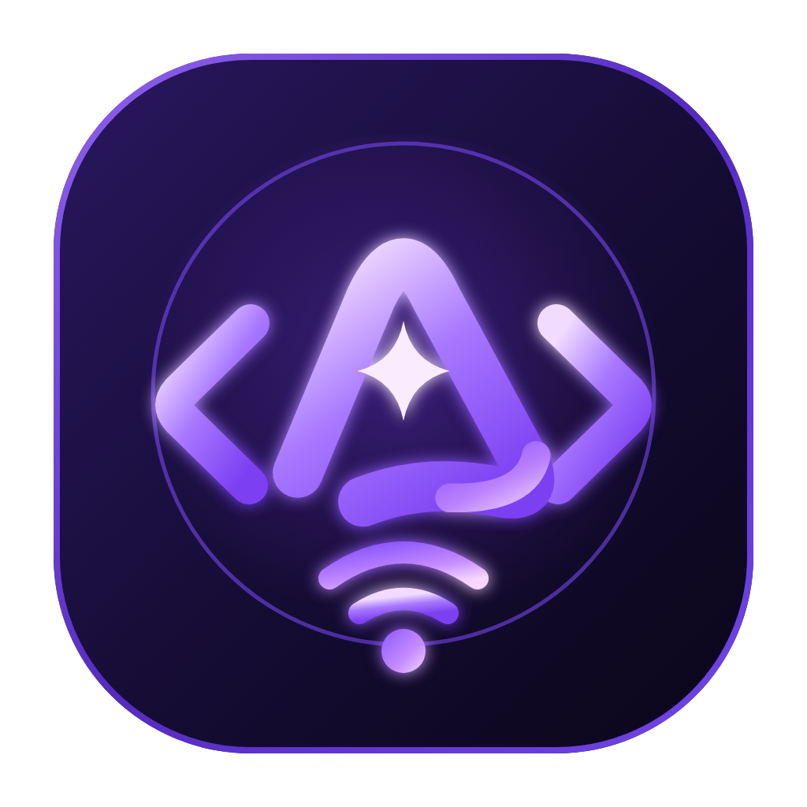

# Nexar

**Управляйте ИИ-агентами на своём ПК с телефона.**

Nexar связывает телефон и компьютер: вы пишете задачу в чате на телефоне, а агент (Claude Code, Qwen, Codex, OpenCode) выполняет её на ПК. Ничего не нужно открывать в облаке — агенты работают локально, под вашим входом.

## Возможности

- **Чат как в мессенджере** с любым агентом; быстрое удаление чатов свайпом и очистка списка.
- **Подтверждение действий с телефона.** Опасная команда не запустится, пока вы не нажмёте «Разрешить» (приходит уведомление).
- **Модель и уровень рассуждений** выбираются в чате. Приложение само узнаёт у агента, какие модели доступны на вашем тарифе, и не предлагает лишнего.
- **Контекстное окно чата:** видно, сколько занято и чем (сообщения, инструменты, Skills…). Автосжатие при заполнении и кнопка «Сжать сейчас», когда агент закончил работу.
- **Skills:** установка (в том числе папки skills Claude Code), включение, параметры, удаление; подключаются к агенту в каждом чате.
- **Память проекта:** агент сам сохраняет и находит факты о проекте, а не изучает код заново.
- **Карта проекта:** индекс классов, функций и связей между файлами, обновляется сама. Агент находит нужное по карте и экономит токены.
- **Интеграции:** GitHub, базы данных, Docker, IDE, S3. Подключение, проверка соединения, ключи хранятся зашифрованными.
- **Файловый менеджер ПК:** все диски и папки, просмотр и правка текста, создание, переименование, копирование, удаление в Корзину.
- **Живые метрики ПК:** CPU, RAM, GPU, диск и сеть обновляются каждую секунду.
- **Рабочее место сессии на ПК:** вкладки «Чат / Файлы / Терминал / Изменения» и одна боковая панель.
- **Терминал ПК на телефоне:** вкладки, быстрые клавиши (Tab, Ctrl+C, стрелки), подсказки по Tab.
- **Файлы ПК** и **подсветка кода** в ответах в стиле VS Code.
- **Оценки моделей** (👍/👎) и **стоимость каждой задачи**; **расписание** задач и краткая сводка по работе.
- **Работает и со слабыми моделями:** без особых возможностей агент всё равно отвечает, а команды из ответа можно запустить кнопкой «Выполнить на ПК».
- **Связь без открытых портов.** По Wi-Fi напрямую или через реле на Cloudflare со сквозным шифрованием (AES-256-GCM): реле не видит содержимого.

## Установка

Скачайте файлы из раздела [Releases](../../releases/latest):

1. **Windows:** распакуйте `Nexar-windows.zip` и запустите `Nexar.exe`. Нужен установленный [Node.js 22+](https://nodejs.org) и хотя бы один агент (например, Claude Code).
2. **Android 8+:** установите `Nexar.apk` (разрешите установку из неизвестных источников).
3. На ПК откройте *Настройки → Удалённый доступ* и отсканируйте QR-код телефоном.

> Сборка подписана отладочным ключом: Android может показать предупреждение при установке.

## Статус

Ранняя версия 0.3.0. Исходный код не публикуется, здесь только готовые сборки.
